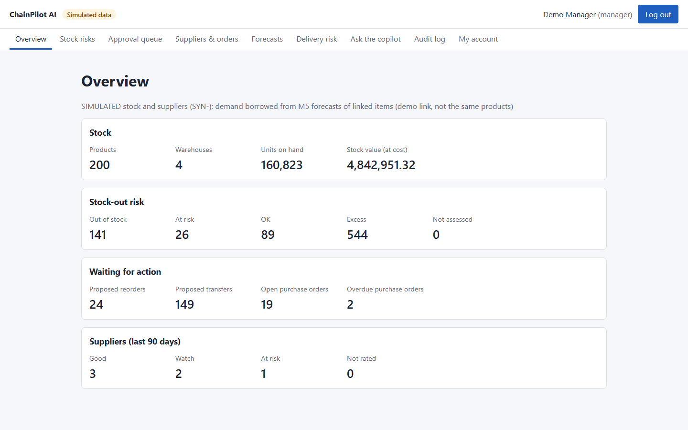
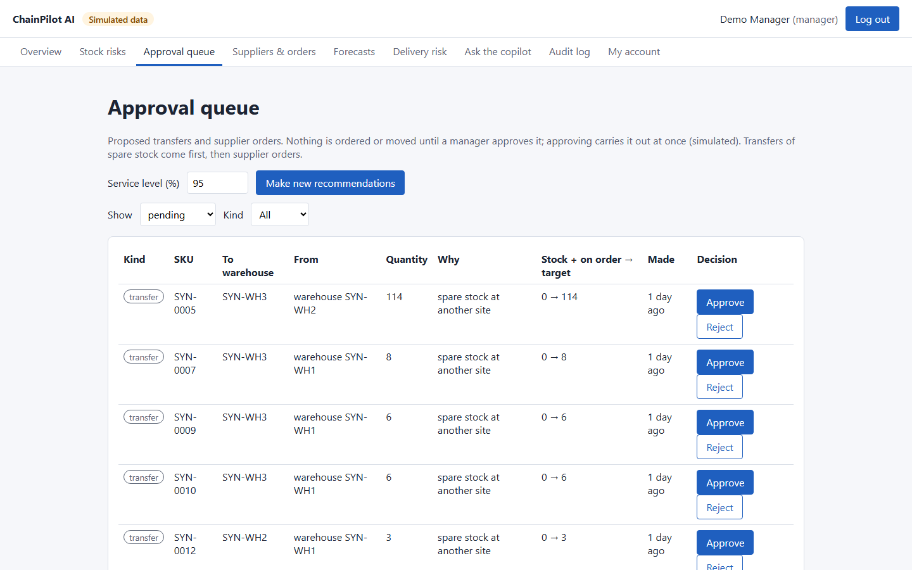
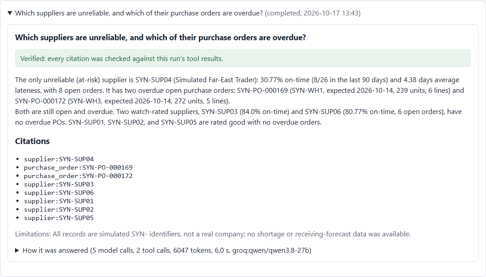
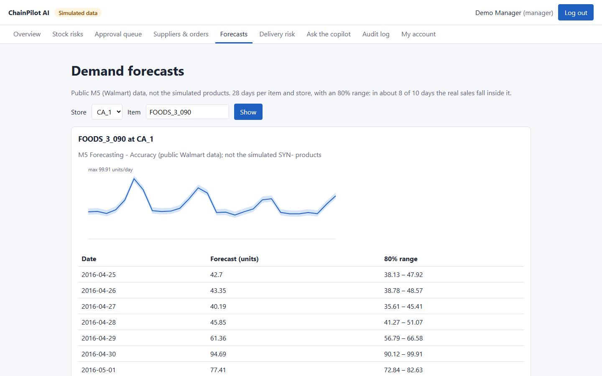
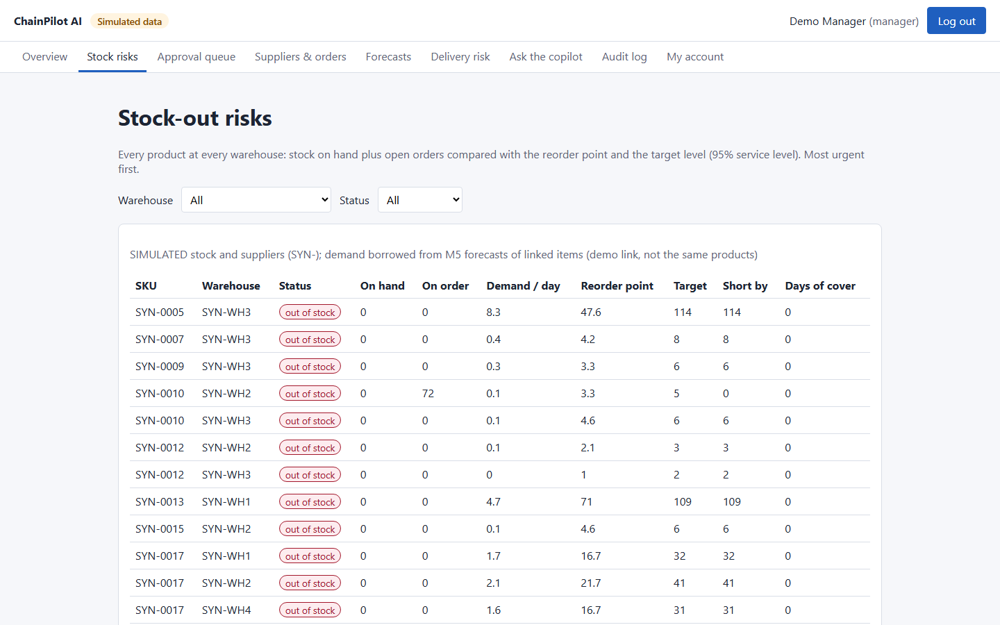
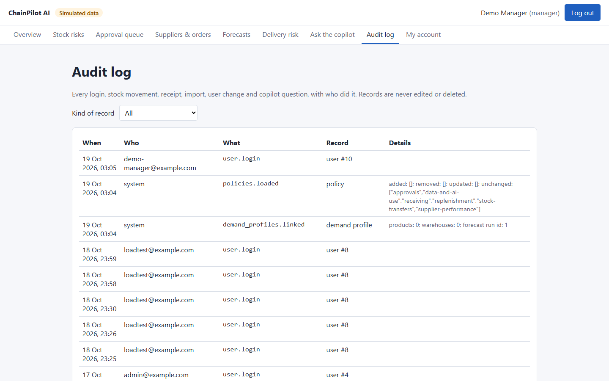
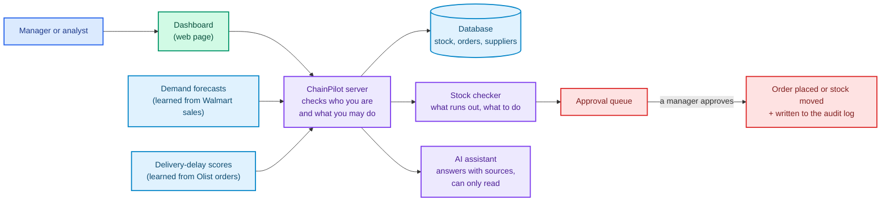

<div align="center">

# ChainPilot AI

**An AI-assisted control room for a store chain's stock and suppliers**

[](https://python.org)
[](https://fastapi.tiangolo.com)
[](https://react.dev)
[](https://postgresql.org)
[](https://lightgbm.readthedocs.io)
[](https://langchain-ai.github.io/langgraph/)
[](https://aws.amazon.com)

*Predict what will sell → spot what is running out → suggest what to move or order → **a person approves** → everything is recorded.*

</div>

---

## The problem, in plain words

Picture a store chain with **4 warehouses and 200 products**. Every morning someone has to answer the same questions:

- *Which products are about to run out, and where?*
- *Can another warehouse spare some, or do we need to order from a supplier?*
- *Which suppliers keep delivering late?*
- *Which deliveries are likely to arrive late?*

Doing this by hand in spreadsheets is slow and easy to get wrong. **ChainPilot AI does the checking and the arithmetic, explains its reasons, and suggests actions. A manager still has the final say:** nothing is ordered or moved until a manager approves it.

> **Important: no real company data.** The warehouses, products, stock and suppliers are **made up** (every screen shows a "Simulated data" label). The sales history used to learn demand comes from a public dataset of **Walmart** sales (M5). The delivery-delay model is trained on public orders from **Olist**, a Brazilian online marketplace. ChainPilot has no access to any real company's systems.

---

## What a morning looks like

1. The manager opens the dashboard. **The overview** shows that 146 product-and-warehouse combinations are out of stock and 24 more are close to running out.
2. They click **Make new recommendations**. ChainPilot proposes **174 actions**: 150 times *"move spare stock from another warehouse"* and 24 times *"order from the supplier"*. Each one shows the numbers it is based on.
3. They ask the **AI assistant**: *"Which suppliers are unreliable, and which of their orders are overdue?"* It answers in plain sentences, **with sources**, marked "Verified" when every source was checked.
4. They **approve** a transfer and an order, and **reject** one with a reason. Approving places the (simulated) purchase order or moves the stock at once.
5. The **audit log** shows who approved what, and when. Nothing can be quietly changed afterwards.

A step-by-step 10-minute demo: [docs/DEMO.md](docs/DEMO.md).

---

## What it looks like

| | |
|:---:|:---:|
|  |  |
| **Overview:** the headline numbers at a glance | **Approval queue:** every suggestion waits for a manager |
|  |  |
| **AI assistant:** a "Verified" answer with its sources | **Forecasts:** expected sales with the likely range |
|  |  |
| **Stock risks:** most urgent first | **Audit log:** who did what, and when |

*Screenshots of the local demo with simulated data, taken after some test approvals and deliveries, so a few numbers differ from the morning story above.*

---

## How it works



More detailed diagrams for technical readers: [docs/ARCHITECTURE.md](docs/ARCHITECTURE.md).

---

<div align="center">

## The five parts

| Part | What it does, in plain words | How we know it works |
|:---:|:---|:---|
| **Demand forecaster** | Learns from past Walmart sales how much of each item sells per day, and predicts the next 28 days, with a "likely range" | Tested on 28 days of real sales it had never seen |
| **Stock checker** | For every product in every warehouse: *"Will this run out before a new delivery could arrive?"* Then it suggests moving spare stock first, and ordering only what is still missing | A fixed, written-down formula with tests; replayed on real sales history |
| **Delivery-delay scorer** | Gives each shipped order a *high / medium / low* risk of arriving late, with the top 3 reasons | Checked against what really happened to 32,422 orders |
| **AI assistant** | Answers questions in plain language using only ChainPilot's own data and company rules, and shows its sources | Every source is checked automatically; 14 test questions, including tricks meant to make it misbehave |
| **Approval desk** | Managers approve or reject each suggestion; approved ones are carried out and recorded | Tested so that two managers clicking at the same moment cannot place the same order twice |

</div>

---

## What the screens show

| Screen | What you see |
|:---|:---|
| **Overview** | The headline numbers: stock, risks, open orders, supplier ratings |
| **Stock risks** | Every product at every warehouse, most urgent first, with how many days of stock are left |
| **Approval queue** | The suggested transfers and orders, each with Approve and Reject buttons (managers only) |
| **Suppliers & orders** | How often each supplier delivered on time, and which orders are overdue |
| **Forecasts** | A chart of expected sales for the next 28 days, with the likely range |
| **Delivery risk** | Each day's shipments that are most likely to arrive late, and why |
| **Ask the copilot** | Questions in plain language, answers with sources |
| **Audit log** | Who did what, and when (managers and admins) |
| **Users** | Adding people and setting their role (admins only) |

There are three kinds of user: **analysts** can look, **managers** can also approve, and **admins** can also manage users.

---

<div align="center">

## Results (measured, not guessed)

| Question | Answer | Details |
|:---|:---|:---:|
| Are the forecasts better than a simple average? | Yes, a little. On 28 days of sales it had never seen, its errors were **about 3% smaller** than "average of the last 4 weeks". The likely range held the real sales **80% of the time**, as intended. Daily sales of single items are very unpredictable, so every method makes large errors; that is why the stock formula adds a safety buffer. It also tends to guess **5–8% too low**. | [results](docs/MODEL_RESULTS.md#final-check-on-untouched-data-the-published-forecasts-p2-t4) |
| Does the delivery-risk score help? | Yes. Orders it marked **high risk were late 1 time in 5 (19.9%)**; low-risk ones only 1 time in 50 (2.0%). The 10% of orders it flags contain **42.5% of all late deliveries**. Most flagged orders still arrive on time: a flag means "keep an eye on this". | [results](docs/MODEL_RESULTS.md#delivery-delay-risk-published-scores-and-tier-check-p3-t3) |
| Does better forecasting save stock? | Replayed on real Walmart sales: with the forecasts, the stock formula needed **17–34% less stock** to meet the same share of customer demand. | [results](docs/MODEL_RESULTS.md#inventory-policy-replay-on-real-demand-p4-t2) |
| Does the AI assistant behave? | It passed **12 of 14** test questions, twice. The pass mark was set before testing: the first run met it; the second fell short on 2 checks of safe wording. Both runs are reported. | [results](docs/MODEL_RESULTS.md#ai-copilot-first-real-evaluation-p5-t4) |
| Is it fast enough? | Online, with 10 people using it at once for a minute: **1,170 requests, no errors**, and 95% of answers within **1.1 seconds**. | [results](docs/results/p9_load_and_security.md) |

</div>

---

## Is it safe?

- **People decide, not the computer.** Every order and stock transfer needs a manager's approval. The AI assistant can only *read*: it cannot approve, order or change anything.
- **Each role can only do its own job.** An analyst cannot approve, and only admins manage users. The server checks this on every action; an automatic test tries all 43 kinds of action with the wrong role and makes sure each is refused.
- **Nothing is quietly overwritten.** Every change in stock is written down as a new entry, with who made it. The audit log is never edited.
- **Logins are protected.** Passwords are stored scrambled (hashed), repeated wrong passwords lock the account for 15 minutes, and the browser login cannot be read by other scripts.
- **Honest about mistakes.** Plans for every test were written down *before* running it. Failures are reported as failures, and open problems are listed in the [review queue](docs/REVIEW_QUEUE.md).

---

## Try it yourself

You need **Docker Desktop** (and, on Windows, **Git Bash**).

```bash
git clone https://github.com/sunilsaini01/chainpilot-ai
cd chainpilot-ai
cp .env.example .env          # set POSTGRES_PASSWORD; GROQ_API_KEY + GROQ_MODEL for the AI assistant
docker compose up -d --build
bash scripts/demo-setup.sh    # loads the demo data and prints three demo logins once
```

Open **http://127.0.0.1:8080** and log in with one of the printed demo logins (admin, manager or analyst).

- The forecasts and delivery scores come from the public datasets (download guide: [docs/DATASETS.md](docs/DATASETS.md)). Without them, the setup uses a small made-up set of forecasts, and the numbers differ from the ones above.
- The AI assistant needs a free key from [Groq](https://console.groq.com). Without one, every other screen works, and the assistant says it is not set up.

---

## Online version (AWS)

ChainPilot also runs on Amazon Web Services. It is switched on **only for demo days** to keep costs low (about $1.5–2 a day). It was set up with code (Terraform), not by clicking around, so it can be rebuilt the same way every time:

- **Secure web address** (HTTPS) for the dashboard; the server and the database are not reachable from the internet directly.
- **Updates go out through GitHub** with a review step: GitHub shows exactly what will change, the owner approves, then it deploys and tests itself.
- **Safety nets, tested for real:** a broken update was rolled back automatically with no downtime, and alarm emails reach the owner.

How it was planned and how to run it: [docs/AWS_PLAN.md](docs/AWS_PLAN.md) · [docs/AWS_RUNBOOK.md](docs/AWS_RUNBOOK.md).

---

## What it does not do (honest limits)

- **The data is made up or public.** The results say nothing about any real company. Walmart sales are *borrowed* to give the made-up products a realistic demand pattern.
- **The forecasts tend to be a little low** (5–8%); the safety buffer covers part of this.
- **Simplified logistics:** moved stock arrives instantly (no travel time), there are no shipping costs or budgets, and orders arrive in full.
- **The AI assistant can still be wrong** in ways the checks do not catch. The free AI service also limits how many questions can be asked per minute.
- **No "forgot password" email:** an admin sets a temporary password instead.
- **The online version is for demos,** not for a real business (one small server, no backup copy in a second location).
- Background jobs (for example, re-training forecasts from the dashboard) were not built: forecasts are prepared separately and then loaded.

The full list, item by item, is in [docs/ACCEPTANCE.md](docs/ACCEPTANCE.md) and [docs/REVIEW_QUEUE.md](docs/REVIEW_QUEUE.md).

---

<div align="center">

## Under the hood (for technical readers)

| Area | Technology | Detail |
|:---:|:---|:---|
| **Server** | Python 3.11, FastAPI, SQLAlchemy, Alembic | Roles checked on every endpoint; 12 database migrations |
| **Database** | PostgreSQL 16 | Append-only stock ledger; row locks for approvals; full-text search for policies |
| **Dashboard** | React 19, TypeScript, Vite | Loading, error and empty states; automatic accessibility checks (WCAG 2.1 A/AA) |
| **Forecasting** | LightGBM | Weekly model with a calibrated 80% range; rolling backtests against simple baselines |
| **Delivery risk** | Logistic regression (compared with LightGBM) | Time-based split, calibrated, with the top-3 reasons per order |
| **AI assistant** | LangGraph + Groq | A supervisor and 4 specialists; read-only database tools; every citation checked |
| **Security** | Cookie sessions + CSRF tokens, scrypt passwords | Login rate limits; strict browser security headers; dependency scans in CI |
| **Cloud** | AWS: CloudFront, S3, ECS Fargate, RDS, CloudWatch | Terraform; GitHub OIDC deploys with approval; no stored AWS keys |

</div>

| Tests | Count |
|:---|---:|
| Server (with a real database) | 505 |
| Machine-learning pipelines | 131 |
| Dashboard | 54 |
| Full browser tests (Chromium) | 26 |
| **Total** | **716** |

All of them run on every change ([CI](.github/workflows/ci.yml)), together with lint, the dashboard build, Terraform checks and a Docker smoke test.

---

## Documentation

| Document | For whom | What is in it |
|:---|:---|:---|
| [docs/DEMO.md](docs/DEMO.md) | Anyone presenting | The 10-minute walkthrough |
| [docs/ARCHITECTURE.md](docs/ARCHITECTURE.md) | Technical readers | Diagrams and how a request flows |
| [docs/ACCEPTANCE.md](docs/ACCEPTANCE.md) | Reviewers | Every requirement: met, partly, not met, with proof |
| [docs/MODEL_RESULTS.md](docs/MODEL_RESULTS.md) | Data scientists | All model and evaluation results |
| [docs/DATASETS.md](docs/DATASETS.md) | Anyone running it | Where the public data comes from |
| [docs/REFERENCE.md](docs/REFERENCE.md) | Developers | Every API, setting and setup detail |
| [docs/DECISIONS.md](docs/DECISIONS.md) | Developers | Why things were built the way they were |
| [docs/AWS_PLAN.md](docs/AWS_PLAN.md) · [docs/AWS_RUNBOOK.md](docs/AWS_RUNBOOK.md) | Operators | Cloud design, costs and day-to-day running |
| [docs/REVIEW_QUEUE.md](docs/REVIEW_QUEUE.md) | Reviewers | Known problems, open and fixed |
| [docs/CLAUDE_WORK_LOG.md](docs/CLAUDE_WORK_LOG.md) | Anyone curious | The full history of how it was built |
