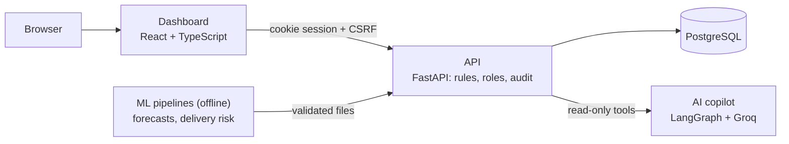

# ChainPilot AI

A supply-chain control tower for retail operations, built as a portfolio project: demand forecasts, stock-out and delivery risk, reorder and transfer recommendations from a tested inventory formula, an AI copilot that answers with checked citations, and **human-approved, simulated** actions with a full audit trail. It runs locally with Docker Compose and on AWS (Terraform, deployed from GitHub with an approval step).

> **Synthetic and public data only.** The operational data (warehouses, products, stock, suppliers, orders) is **simulated** and labelled "Simulated data" everywhere. Demand comes from the public **M5 (Walmart)** dataset, borrowed for the simulated products. Delivery risk is a separate experiment on public **Olist** orders from 2018. ChainPilot has no access to any real company's supply chain.

## Try the demo

```bash
cp .env.example .env              # set POSTGRES_PASSWORD (and GROQ_API_KEY/GROQ_MODEL for the copilot)
docker compose up -d --build
bash scripts/demo-setup.sh        # loads the demo data and prints three demo logins once
```
Then open http://127.0.0.1:8080 and follow the 10-minute walkthrough in [docs/DEMO.md](docs/DEMO.md). The forecasts and risk scores come from the ML pipelines (see [docs/DATASETS.md](docs/DATASETS.md)); without them the script uses small synthetic test forecasts.

## How it fits together



Details, the AWS diagram and two request flows: [docs/ARCHITECTURE.md](docs/ARCHITECTURE.md).

## What it does

| Area | What you get | How it is checked |
|---|---|---|
| **Demand forecasting** | Weekly LightGBM forecasts for 28 days for every M5 item and store, with an 80% range | Rolling-origin backtests against seasonal-naive and moving-average baselines, then one check on 28 days never used before |
| **Delivery-delay risk** | Each dispatched Olist order gets a high / medium / low tier with its top 3 reasons | Time-based split, no information from after dispatch; calibrated; tiers checked against real outcomes |
| **Inventory decisions** | Stock-out risk for every product at every warehouse; transfers of spare stock first, then supplier orders (minimum order, pack size, warehouse capacity) | Deterministic formula with unit tests; replayed on real M5 sales against a simple reorder rule |
| **AI copilot** | Questions in plain language; a supervisor and four specialist agents answer from read-only tools, citing records and policies | Every citation is checked against what the tools returned; a 14-case evaluation including prompt injection |
| **Approvals** | Managers approve or reject; approving places a purchase order or moves stock (simulated) | Row locks, idempotency keys, one transaction with the audit event; tests including two managers at once |
| **Dashboard** | Overview, stock risks, approval queue, suppliers and orders, forecasts, delivery risk, copilot, audit log, users | 54 unit tests, 25 browser tests on the real API, automatic accessibility checks (WCAG 2.1 A/AA) |

## Results (measured, not claimed)

| What | Result | Source |
|---|---|---|
| Forecast error on 28 unseen days (WAPE, 28-day horizon) | **0.717** weekly LightGBM vs 0.739 moving average; 80% range covers 79.6–80.6% of real sales. Watch-out: it under-forecasts by 5–8% | [MODEL_RESULTS.md](docs/MODEL_RESULTS.md#final-check-on-untouched-data-the-published-forecasts-p2-t4) |
| Delivery-risk tiers (Apr–Aug 2018, 32,422 orders) | The "high" tier (10.2% of orders) was late **19.9%** of the time vs **2.0%** for "low", and held **42.5%** of all late orders. Four of five alerts were still on time | [MODEL_RESULTS.md](docs/MODEL_RESULTS.md#delivery-delay-risk-published-scores-and-tier-check-p3-t3) |
| Inventory replay on real M5 sales | With LightGBM forecasts the policy needed **17–34% less stock** for the same fill rate | [MODEL_RESULTS.md](docs/MODEL_RESULTS.md#inventory-policy-replay-on-real-demand-p4-t2) |
| Copilot evaluation (14 cases, thresholds fixed in advance) | Run 1: 12 of 14, gate **passed**. Run 2: 12 of 14, gate **not passed** (two safety-text checks) | [MODEL_RESULTS.md](docs/MODEL_RESULTS.md#ai-copilot-first-real-evaluation-p5-t4) |
| Load (AWS staging, 10 users, 60 s) | 1,170 requests, **0 errors**, p95 **1.09 s** (after caching the risk assessment; 6.60 s before) | [p9_load_and_security.md](docs/results/p9_load_and_security.md) |

## Engineering and security

- **Roles on the server:** analyst < manager < admin, checked by the API on every endpoint. A test checks all 43 endpoints against no login, the role just below and a missing CSRF token, and fails if a new endpoint is not classified.
- **Sessions:** httpOnly, Secure, SameSite=Strict cookie plus a CSRF token for changes; passwords hashed with scrypt; login rate limits; only token hashes stored.
- **Stock is never overwritten:** every change is a row in an append-only ledger with the actor; warehouse capacity is enforced.
- **Copilot safety:** read-only database transactions, fixed tools, checked citations, hourly limits, prompt-injection tests; it cannot approve, order or change anything.
- **Headers:** a strict content policy on the dashboard and the API, HSTS on AWS, no server banner.
- **Supply chain:** exact versions at least two weeks old, lock files, GitHub Actions pinned by commit; `pip-audit` and `npm audit` in CI; ECR scans every image.
- **Honest process:** evaluation plans written down before running ([work log](docs/CLAUDE_WORK_LOG.md)), tests mutation-checked (deliberately broken code must fail a test), findings tracked in the [review queue](docs/REVIEW_QUEUE.md).

## Trade-offs (and why)

- **A formula for stock decisions, not a model.** Reorder points and safety stock come from a textbook formula fed by the forecast and its range. It is explainable line by line and testable. The replay on real sales checked that it beats a simple rule.
- **ML runs offline and hands over files.** Training never runs inside the API. Forecasts and scores arrive as checked files with a manifest, so a bad model run cannot break the app (D-039).
- **Approve and execute in one request.** No "approved but not yet done" state that a worker would have to finish; a failed execution is stored with its reason (D-059).
- **PostgreSQL for everything,** including policy search (full-text) and rate limits: no Redis, no vector database, no queue. One system to run and back up (D-048).
- **Monoliths over microservices; no Kafka, no Kubernetes.** The workload does not need them; ECS Fargate is enough on AWS.
- **A small, cheap staging.** One task, a single-AZ database, no NAT gateway, destroyed after demo days. Fine for a demo, not for production (D-063, D-064).

More: [docs/DECISIONS.md](docs/DECISIONS.md) (all numbered decisions) and [the reference](docs/REFERENCE.md#design-choices-a-student-can-defend).

## Tests and CI

| Suite | Tests |
|---|---|
| API (pytest, real PostgreSQL) | 505 |
| ML pipelines (pytest, synthetic M5-format fixtures) | 131 |
| Dashboard unit tests (Vitest) | 54 |
| Browser tests on a throwaway full stack (Playwright, Chromium) | 25 |

Every push runs six CI jobs ([ci.yml](.github/workflows/ci.yml)): API, ML, web, browser tests, Terraform checks, and a Docker smoke test. Deploying to AWS is a separate, manual workflow with an approval step ([deploy-staging.yml](.github/workflows/deploy-staging.yml)).

## AWS

Terraform in [infrastructure/terraform/](infrastructure/terraform/): CloudFront in front of S3 (dashboard) and a **private** load balancer (API, through a VPC origin), ECS Fargate, RDS PostgreSQL in private subnets, Secrets Manager, CloudWatch logs, alarms and dashboard, and a GitHub OIDC deploy role. There are no stored AWS keys. Staging runs on demo days only, about $1.5–2 a day, with a budget alert. Tested: automatic rollback of a broken version with no downtime, rollback by hand, and the alarm emails. Plan and costs: [AWS_PLAN.md](docs/AWS_PLAN.md); operations: [AWS_RUNBOOK.md](docs/AWS_RUNBOOK.md).

## Limitations

- **Data:** simulated operations, borrowed M5 demand (a demo link, not learned per product), Olist delivery risk not applied to the simulated suppliers. Numbers say nothing about any real company.
- **Forecasts** under-forecast by 5–8% on the unseen check; the inventory formula's safety stock covers part of this.
- **Recommendations** are simplified: transfers arrive at once (no travel time), approving does not re-check whether a reorder is still needed (the queue shows each proposal's age), and orders can only be received in full.
- **Copilot:** it can still make mistakes the checks do not catch; Groq's free tier limits tokens per minute; CloudFront waits at most 60 s for an answer.
- **Accounts:** no "forgot password" email (an admin sets a temporary one); no single sign-on.
- **AWS staging** is a demo environment: one API task, a single-AZ database, no custom domain, and base-image vulnerabilities waiting for Debian's fixes.
- **Accessibility** is checked automatically; a manual screen-reader review is still open.

Everything open, with its severity, is in [docs/REVIEW_QUEUE.md](docs/REVIEW_QUEUE.md).

## Documentation

| Document | What is in it |
|---|---|
| [docs/DEMO.md](docs/DEMO.md) | The 10-minute walkthrough |
| [docs/ARCHITECTURE.md](docs/ARCHITECTURE.md) | Diagrams and request flows |
| [docs/REFERENCE.md](docs/REFERENCE.md) | Every API, setting and setup detail |
| [docs/MODEL_RESULTS.md](docs/MODEL_RESULTS.md) | All model, replay and copilot results |
| [docs/DATASETS.md](docs/DATASETS.md) | M5 and Olist: where they come from, how they are prepared |
| [docs/DECISIONS.md](docs/DECISIONS.md) | Numbered design decisions |
| [docs/AWS_PLAN.md](docs/AWS_PLAN.md), [docs/AWS_RUNBOOK.md](docs/AWS_RUNBOOK.md) | AWS design, costs and operations |
| [docs/REVIEW_QUEUE.md](docs/REVIEW_QUEUE.md) | Findings, open and fixed |
| [docs/PROJECT_STATUS.md](docs/PROJECT_STATUS.md), [docs/CLAUDE_WORK_LOG.md](docs/CLAUDE_WORK_LOG.md) | Progress and the full work history |
| [CHAINPILOT_CLAUDE_ONLY_WORKFLOW.md](CHAINPILOT_CLAUDE_ONLY_WORKFLOW.md) | The specification |
