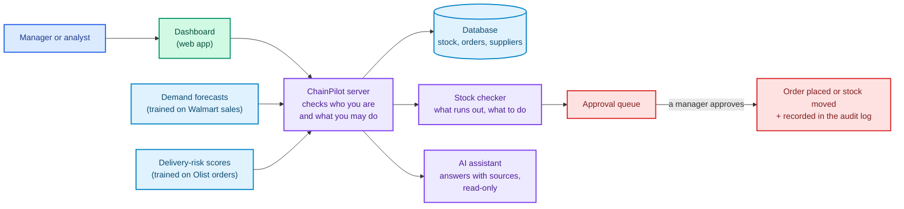

<div align="center">

# ChainPilot AI

**A supply-chain control tower for retail: forecasts, stock risks, supplier insight and AI-assisted decisions, with a person approving every action.**

[](https://github.com/sunilsaini01/chainpilot-ai/actions/workflows/ci.yml)
[](https://python.org)
[](https://fastapi.tiangolo.com)
[](https://react.dev)
[](https://postgresql.org)
[](https://lightgbm.readthedocs.io)
[](https://langchain-ai.github.io/langgraph/)
[](https://aws.amazon.com)

[Overview](#overview) · [Features](#key-features) · [Screenshots](#screenshots) · [How it works](#how-it-works) · [Results](#results) · [Getting started](#getting-started) · [Tests](#testing) · [AWS](#deployment-on-aws) · [Limitations](#limitations) · [Docs](#documentation)

</div>

---

## Overview

Retail teams answer the same questions every day: *What will sell next week? Which products are about to run out, and where? Should we move stock between warehouses or order from a supplier? Which suppliers and deliveries are unreliable?*

**ChainPilot AI** answers these questions in one place:

1. It **forecasts demand** for the next 28 days, with a likely range.
2. It **checks every product at every warehouse** and warns before stock runs out.
3. It **suggests actions**: move spare stock first, order from a supplier only for what is still missing, and show the numbers behind every suggestion.
4. It **scores deliveries** for the risk of arriving late, with the main reasons.
5. An **AI assistant** answers questions in plain language using only the system's own data and company rules, and shows its sources.
6. **A manager approves or rejects** each suggestion. Nothing is ordered or moved without that approval, and every action is recorded in an audit log.

> **Data notice.** No real company data is used. The warehouses, products, stock, suppliers and orders are **simulated**, and every screen is labelled "Simulated data". Demand patterns come from the public **M5 (Walmart) sales dataset**. The delivery-delay model uses public orders from **Olist**, a Brazilian online marketplace. The two datasets are kept separate and are never treated as one company.

---

## Key features

| Feature | What it does | How it was checked |
|:---|:---|:---|
| **Demand forecasting** | Predicts daily sales for 28 days ahead for every M5 item and store, with an 80% likely range | Compared with simple baselines over several past periods, then tested once on 28 days that were never used for training |
| **Stock-out risk** | Labels each product at each warehouse as *out of stock*, *at risk*, *ok* or *excess*, and shows how many days of stock are left | A fixed, documented formula (reorder point and safety stock) covered by unit tests |
| **Recommendations** | Suggests transfers of spare stock first, then supplier orders that respect minimum order quantity, pack size and warehouse space | Replayed on real Walmart sales against a simple reorder rule |
| **Delivery-delay risk** | Gives each shipped order a *high*, *medium* or *low* risk tier and its top three reasons | Time-based split (the model never sees the future), calibrated, and checked against what really happened |
| **AI assistant** | Answers questions such as *"Which suppliers are unreliable?"* with sources, marked "Verified" when every source was checked | Read-only access; every source is checked automatically; 14 test questions, including attempts to trick it |
| **Approval workflow** | Managers approve or reject; approving places a (simulated) purchase order or moves the stock | Protection against double approval, safe retries, and one database transaction per decision |
| **Audit log** | Records who did what and when: logins, stock changes, orders, approvals, user changes, AI questions | Entries are written together with the change and are never edited |
| **User roles** | *Analyst* (view), *Manager* (also approve), *Admin* (also manage users) | All 43 API actions are tested without a login, and with a too-low role wherever one exists |

---

## Screenshots

| | |
|:---:|:---:|
|  |  |
| **Overview:** stock, risks, open orders and supplier ratings | **Approval queue:** every suggestion waits for a manager |
|  |  |
| **AI assistant:** a verified answer with its sources | **Forecasts:** expected sales with the likely range |
|  |  |
| **Stock risks:** most urgent first | **Audit log:** a permanent record of actions |

*Local demo with simulated data. A 10-minute guided walkthrough is in [docs/DEMO.md](docs/DEMO.md).*

---

## How it works



**In short:**
- **The dashboard** only displays information and sends requests. **The server** holds all the rules: it checks the user's role on every request, calculates risks and suggestions, and writes every change to the database together with an audit entry.
- **The machine-learning models run separately** from the server. They produce checked files (forecasts and risk scores), which the server imports. A failed training run can therefore never break the application.
- **The AI assistant** can only use a fixed set of read-only tools. The database itself refuses any change from those tools. Its answers are checked against what the tools returned before they are shown.

Detailed diagrams, including the AWS setup and step-by-step request flows: [docs/ARCHITECTURE.md](docs/ARCHITECTURE.md).

---

## Results

All numbers come from real runs. Test plans and pass marks were written down **before** running, and failures are reported as failures.

| Question | Result | Source |
|:---|:---|:---:|
| **Are the forecasts better than a simple average?** | Yes, slightly. On 28 days never used before, the error was about **3% lower** than a 4-week moving average (WAPE 0.717 vs 0.739). The likely range contained the real sales **79.6–80.6%** of the time, as intended. Single-item daily sales are very unpredictable, so every method has large errors; the stock formula adds a safety buffer for this. The model also tends to forecast **5–8% too low**. | [details](docs/MODEL_RESULTS.md#final-check-on-untouched-data-the-published-forecasts-p2-t4) |
| **Does the delivery-risk score help?** | Yes. Orders marked **high risk were late 19.9%** of the time, compared with **2.0%** for low risk. The 10% of orders flagged as high risk contain **42.5% of all late deliveries** (32,422 orders, April–August 2018). Most flagged orders still arrive on time, so a flag means "monitor this". | [details](docs/MODEL_RESULTS.md#delivery-delay-risk-published-scores-and-tier-check-p3-t3) |
| **Does better forecasting reduce stock?** | In a replay on real Walmart sales, the stock formula needed **17–34% less stock** for the same share of demand met. | [details](docs/MODEL_RESULTS.md#inventory-policy-replay-on-real-demand-p4-t2) |
| **Does the AI assistant behave safely?** | It passed **12 of 14** test cases in each of two runs. The first run met the pass mark that was set in advance. The second missed it on two checks of safe wording. Both runs are reported. | [details](docs/MODEL_RESULTS.md#ai-copilot-first-real-evaluation-p5-t4) |
| **Is it fast enough?** | On AWS, with 10 users at once for one minute: **1,170 requests, no errors**, and 95% of responses within **1.1 seconds**. Before an optimisation (caching the risk calculation), the same test took 6.6 seconds. | [details](docs/results/p9_load_and_security.md) |

---

## Security and reliability

| Area | What is in place |
|:---|:---|
| **Human control** | Every purchase order and stock transfer needs a manager's approval. The AI assistant cannot change anything. |
| **Access control** | Three roles (analyst, manager, admin), checked by the server on every request. An automated test tries all 43 API actions without a login, and with a too-low role wherever one exists. |
| **Login security** | Passwords are stored as secure hashes (scrypt). Accounts lock for 15 minutes after 5 wrong passwords. The browser session is a protected cookie that page scripts cannot read, with an extra token against cross-site requests. |
| **Data integrity** | Stock is never overwritten: every change is a new ledger entry with the person who made it. Approvals lock the record so two managers cannot act on it at the same time, and a repeated click cannot place an order twice. |
| **Web security** | Strict browser security headers, a content policy that blocks unknown scripts, and HTTPS online. |
| **Dependencies** | Exact version pins, automatic vulnerability scans of Python and JavaScript packages on every change, and container image scans on AWS. |
| **Recovery** | Database backup and restore instructions, tested by restoring a full copy and comparing every table. On AWS: automatic rollback of a failed update (tested with no downtime) and alarm emails. |

---

## Technology

| Layer | Technology |
|:---|:---|
| **Backend** | Python 3.11, FastAPI, Pydantic, SQLAlchemy, Alembic (12 database migrations) |
| **Database** | PostgreSQL 16, including full-text search for the company policy documents |
| **Frontend** | React 19, TypeScript, Vite; plain CSS; automatic accessibility checks (WCAG 2.1 A/AA) |
| **Machine learning** | pandas, scikit-learn, LightGBM; rolling backtests; calibrated probabilities |
| **AI assistant** | LangGraph (a supervisor with four specialist agents), Groq language model, structured JSON outputs |
| **Testing** | pytest, Vitest, Testing Library, Playwright (browser), axe (accessibility) |
| **Infrastructure** | Docker Compose (local); AWS CloudFront, S3, ECS Fargate, RDS, Secrets Manager, CloudWatch; Terraform |
| **CI/CD** | GitHub Actions: six checks on every push, plus a manual deployment workflow with an approval step |

---

## Project structure

```text
chainpilot-ai/
├── apps/
│   ├── api/            # Backend: FastAPI server, database models, rules, AI assistant (app/copilot/)
│   │   ├── app/        #   Application code
│   │   ├── migrations/ #   Database migrations (Alembic)
│   │   ├── policies/   #   Simulated company policy documents used by the AI assistant
│   │   └── tests/      #   Backend tests
│   └── web/            # Frontend: React dashboard
│       ├── src/        #   Pages, components and unit tests
│       └── e2e/        #   Browser tests (Playwright)
├── ml/                 # Machine learning: forecasting, delivery risk, inventory replay (+ tests)
├── infrastructure/
│   ├── terraform/      # AWS setup: bootstrap (one-time) and staging
│   └── scripts/        # Deployment helpers, smoke test, load test
├── scripts/            # demo-setup.sh: loads the demo data and creates demo users
├── docs/               # Documentation, results, decisions and the work log
├── .github/workflows/  # CI and the staging deployment workflow
├── docker-compose.yml  # Local stack: database, migrations, API, dashboard
└── .env.example        # Configuration template
```

---

## Getting started

### Requirements
- [Docker Desktop](https://www.docker.com/products/docker-desktop/)
- On Windows: **Git Bash** (comes with [Git for Windows](https://git-scm.com/download/win)) to run the setup script
- Optional: a free [Groq](https://console.groq.com) API key for the AI assistant
- Optional: the public M5 and Olist datasets, for the real forecasts and risk scores (see [docs/DATASETS.md](docs/DATASETS.md))

### Installation

```bash
# 1. Get the code
git clone https://github.com/sunilsaini01/chainpilot-ai
cd chainpilot-ai

# 2. Create the configuration file and set at least POSTGRES_PASSWORD
cp .env.example .env
#    For the AI assistant, also set GROQ_API_KEY and GROQ_MODEL

# 3. Start the application (database, API and dashboard)
docker compose up -d --build

# 4. Load the demo data and create three demo users (safe to run again)
bash scripts/demo-setup.sh
```

The setup script prints three demo logins (admin, manager and analyst) **once**; keep them. Then open **http://127.0.0.1:8080** and log in.

**Without the public datasets,** the script loads a small set of synthetic test forecasts instead, so every screen still works, but the numbers differ from the results above. **Without a Groq key,** everything works except the AI assistant, which shows a clear "not set up" message.

### Configuration

All settings are environment variables in `.env` (template: [.env.example](.env.example)). The most important ones:

| Variable | Purpose |
|:---|:---|
| `POSTGRES_PASSWORD` | Database password (required) |
| `GROQ_API_KEY`, `GROQ_MODEL` | AI assistant provider (optional) |
| `ACCESS_TOKEN_TTL_MINUTES` | How long a login lasts (default 480 = 8 hours) |
| `API_HOST_PORT`, `WEB_HOST_PORT` | Local ports (defaults 8000 and 8080) |
| `CORS_ORIGINS`, `WEB_API_URL` | Allowed browser origins and the API address the dashboard uses |

The full list and every API endpoint are in [docs/REFERENCE.md](docs/REFERENCE.md).

---

## Testing

| Suite | Tests | How to run |
|:---|---:|:---|
| Backend (with a real PostgreSQL database) | 505 | `cd apps/api && RUN_DB_TESTS=1 pytest` (database running; see [REFERENCE.md](docs/REFERENCE.md)) |
| Machine learning | 131 | `cd ml && pytest` |
| Dashboard unit tests | 54 | `cd apps/web && npm test` |
| Browser tests on a temporary full stack | 26 | `bash apps/web/e2e/run-e2e.sh` |
| **Total** | **716** | |

Every push to GitHub runs six automatic checks ([ci.yml](.github/workflows/ci.yml)): backend, machine learning, dashboard (type-check, tests, build, vulnerability scan), browser tests, Terraform validation, and a Docker build-and-start test. Key tests are **mutation-checked**: the code was deliberately broken to confirm that a test fails.

---

## Deployment on AWS

ChainPilot runs on Amazon Web Services as a **staging environment** that is switched on for demos and switched off afterwards, to keep costs low (about $1.5–2 per day while running).

- **Infrastructure as code:** everything is defined in Terraform ([infrastructure/terraform/](infrastructure/terraform/)), so it can be rebuilt identically at any time.
- **Secure by design:** a single HTTPS address (CloudFront) serves the dashboard and the API. The server and database have no public access, and passwords and keys are kept in AWS Secrets Manager.
- **Controlled releases:** a GitHub workflow builds the new version, shows exactly what will change, and **waits for the owner's approval** before deploying. It then runs database migrations and live checks. GitHub signs in to AWS without any stored AWS keys.
- **Monitoring:** CloudWatch logs, a dashboard, and email alarms for errors, unhealthy servers, high load and low database storage.
- **Tested safety nets:** a deliberately broken release was rolled back automatically with no downtime, a manual rollback to an earlier version worked, and the alarm emails were received.

Design, costs and operating guide: [docs/AWS_PLAN.md](docs/AWS_PLAN.md) and [docs/AWS_RUNBOOK.md](docs/AWS_RUNBOOK.md).

---

## Limitations

This is a portfolio project. Its known limits are stated openly:

- **Data:** the operational data is simulated, and the Walmart demand is *borrowed* to give the simulated products realistic patterns. The results do not describe any real company.
- **Forecasts** tend to be 5–8% low; the safety buffer in the stock formula covers part of this.
- **Simplified logistics:** transfers arrive instantly, there are no shipping costs or budgets in the suggestions, and orders are received in full.
- **AI assistant:** it can still make mistakes that the automatic checks miss. The free model tier limits how many questions can be asked per minute.
- **Accounts:** there is no "forgot password" email; an administrator sets a temporary password instead.
- **Not built:** background jobs (for example, retraining from the dashboard) and three tables from the original plan (shipments, daily sales, risk alerts).
- **Accessibility:** automatic checks and a keyboard-only test pass; a manual screen-reader review has not been done ([script ready](docs/ACCESSIBILITY_CHECK.md)).
- **AWS staging** is a demo environment (one server, a single-zone database, no custom domain), not a production system.

Every requirement, with its status and evidence: [docs/ACCEPTANCE.md](docs/ACCEPTANCE.md). Open findings: [docs/REVIEW_QUEUE.md](docs/REVIEW_QUEUE.md).

---

## Documentation

| Document | Contents |
|:---|:---|
| [DEMO.md](docs/DEMO.md) | 10-minute guided walkthrough |
| [ARCHITECTURE.md](docs/ARCHITECTURE.md) | System diagrams and request flows |
| [REFERENCE.md](docs/REFERENCE.md) | Every API endpoint, setting and setup detail |
| [MODEL_RESULTS.md](docs/MODEL_RESULTS.md) | All model, simulation and AI evaluation results |
| [DATASETS.md](docs/DATASETS.md) | Where the public data comes from and how it is prepared |
| [ACCEPTANCE.md](docs/ACCEPTANCE.md) | Requirement-by-requirement checklist with evidence |
| [DECISIONS.md](docs/DECISIONS.md) | Numbered design decisions and their reasons |
| [AWS_PLAN.md](docs/AWS_PLAN.md) · [AWS_RUNBOOK.md](docs/AWS_RUNBOOK.md) | Cloud design, costs and operations |
| [REVIEW_QUEUE.md](docs/REVIEW_QUEUE.md) | Known issues, open and resolved |
| [PROJECT_STATUS.md](docs/PROJECT_STATUS.md) · [CLAUDE_WORK_LOG.md](docs/CLAUDE_WORK_LOG.md) | Progress and the complete build history |

---

## Acknowledgements and license

- **M5 Forecasting – Accuracy** (Walmart sales), via [Kaggle](https://www.kaggle.com/competitions/m5-forecasting-accuracy/data).
- **Brazilian E-Commerce Public Dataset by Olist**, via [Kaggle](https://www.kaggle.com/datasets/olistbr/brazilian-ecommerce).
- The datasets are not included in this repository; download them under their own terms.

No open-source license has been chosen yet, so all rights are reserved by default.

<div align="center">

Built by [@sunilsaini01](https://github.com/sunilsaini01)

</div>
