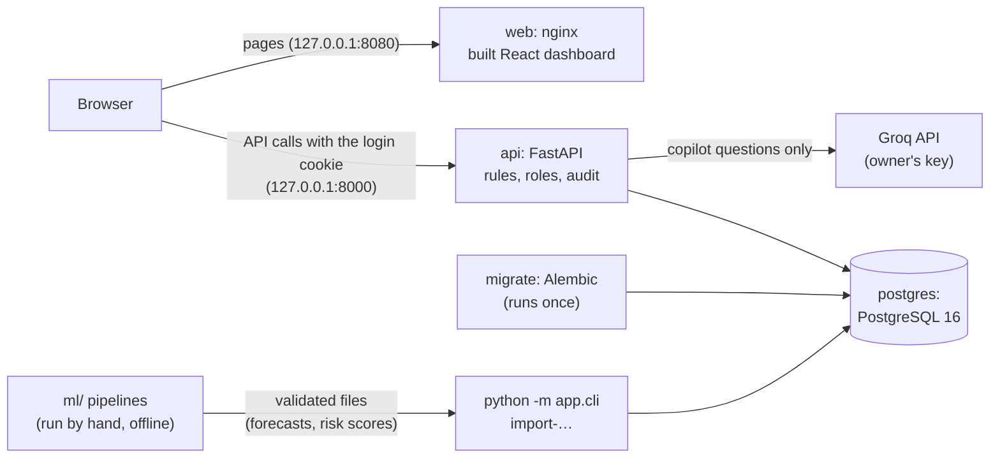
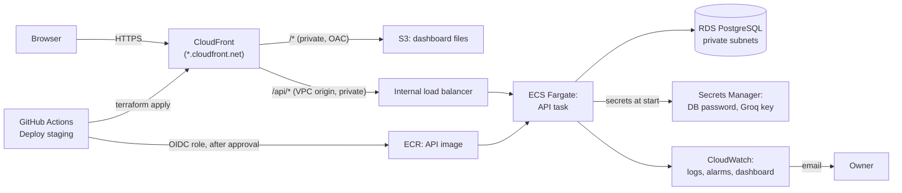
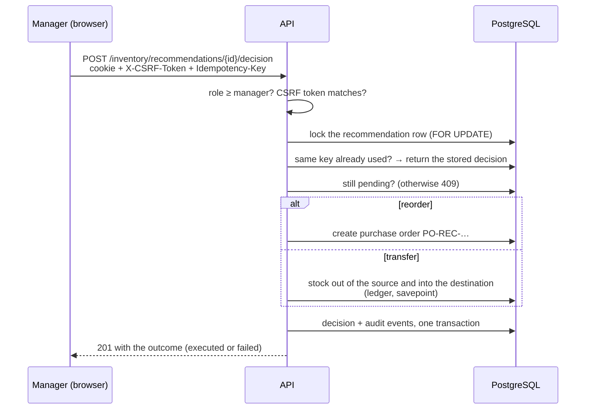
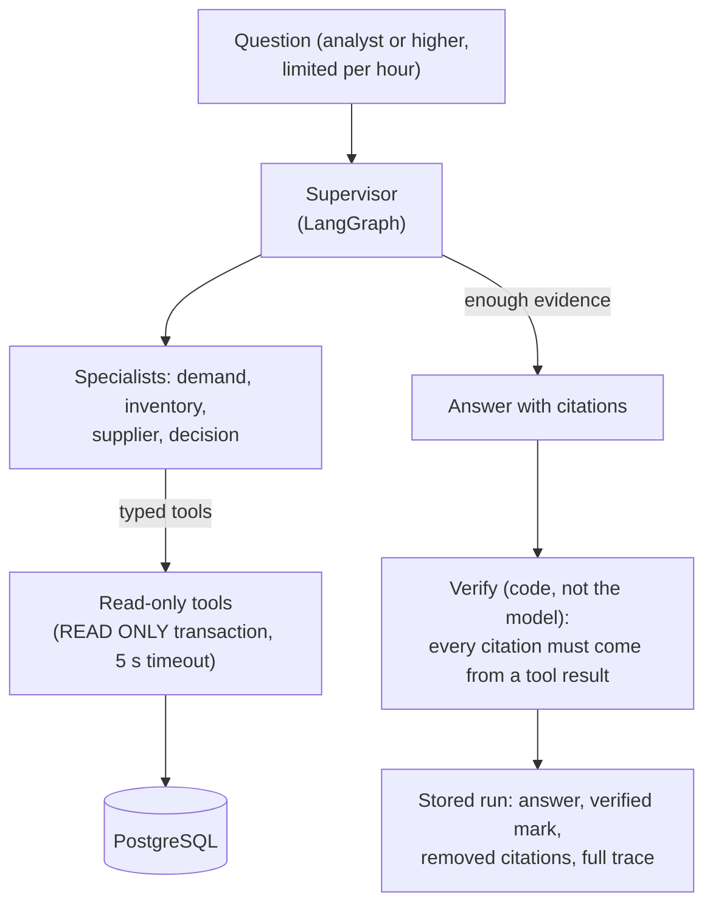

# Architecture

ChainPilot AI has four parts: an **API** (FastAPI + PostgreSQL) that owns all data and rules, a **dashboard** (React) that only shows and asks, **ML pipelines** that run offline and hand over validated files, and an **AI copilot** inside the API that can read but never change anything. Design decisions are numbered in [DECISIONS.md](DECISIONS.md) (D-xxx below).

## Local stack (Docker Compose)

- The browser talks to the API directly; the API allows only the listed origins (CORS) and checks the CSRF token on changes (D-061).
- The ML code never runs inside the API. It writes a folder with a manifest and a checksum, and the API imports it after checking every row (D-039, D-043).

## AWS staging (demo days only, ap-south-1)

- **One address** for the dashboard and the API (CloudFront), so the SameSite=Strict cookie works, and HTTPS needs no domain (D-064).
- The load balancer has **no public address**; CloudFront reaches it through a VPC origin (D-065). The database accepts connections only from the API.
- No NAT gateway: the API task has a public IP but accepts traffic only from the load balancer.
- Deploys: plan, the owner's approval in a protected GitHub environment, apply, migrate, upload, smoke test (D-066). The ECS circuit breaker rolls a broken version back by itself (tested, [AWS_RUNBOOK.md](AWS_RUNBOOK.md)).

## Request flow: approving a recommendation

The row lock stops two managers acting at once; the idempotency key makes a retried click safe; everything is one transaction, so there is no half-done approval (D-059).

## Request flow: a copilot question

The model can only call the listed tools, and the database itself refuses writes in those transactions. An answer whose citations were not returned by a tool is marked "not verified" (D-050, D-051, D-053).

## Where things live

| Part | Code | More |
|---|---|---|
| API, rules, roles, audit | `apps/api/app/` | [REFERENCE.md](REFERENCE.md) |
| Database schema | `apps/api/app/models.py`, `apps/api/migrations/` | migrations 0001–0012 |
| Dashboard | `apps/web/src/` | browser tests in `apps/web/e2e/` |
| Demand forecasting | `ml/demand_forecasting/` | [MODEL_RESULTS.md](MODEL_RESULTS.md) |
| Delivery risk | `ml/delivery_risk/` | [MODEL_RESULTS.md](MODEL_RESULTS.md) |
| Inventory replay | `ml/inventory_sim/` | [MODEL_RESULTS.md](MODEL_RESULTS.md) |
| Copilot | `apps/api/app/copilot/` | [REFERENCE.md](REFERENCE.md) |
| AWS | `infrastructure/terraform/`, `.github/workflows/deploy-staging.yml` | [AWS_PLAN.md](AWS_PLAN.md), [AWS_RUNBOOK.md](AWS_RUNBOOK.md) |
